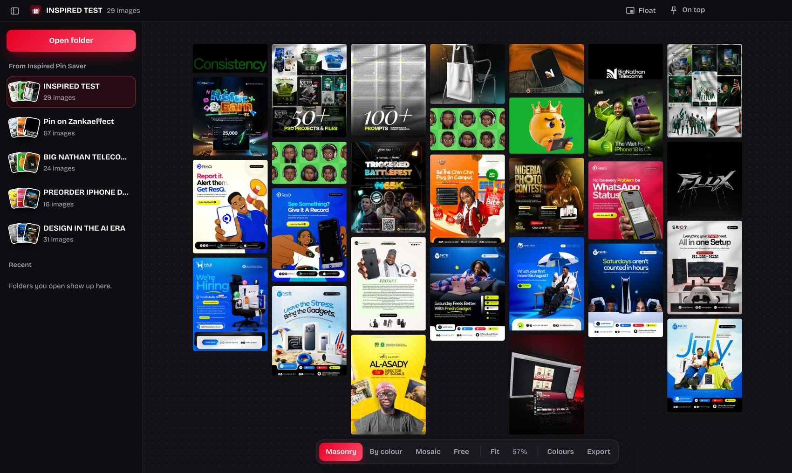

# Inspired Moodboard

A desktop moodboard for your Pinterest saves. Open any folder of images and it becomes one clean
board you can keep floating over Photoshop, Figma or Canva: arrange it by colour, feature favourites,
make it see-through, and drag pictures straight into your design. Free, works offline, nothing is uploaded.

Works with the **Inspired Pin Saver** Chrome extension: collections it saves into `Downloads\Pinterest`
show up in the app by themselves.



## What's in this repo

```
app/                 The app itself (Electron). Edit these to change the app.
  main.js            Desktop side: windows, folders, on-top/float, export, file access
  preload.js         The safe bridge between the page and the desktop side
  renderer/          The screens
    index.html       Layout of the window (title bar, sidebar, toolbar, side panel)
    app.css          All colours, fonts, spacing and animation
    app.js           Board logic: arrange modes, colour sorting, zoom, drag, shortcuts
installer/           The Windows installer (one C# file, no other tools)
  Setup.cs           Install / update / uninstall screens and logic
  app.manifest       Windows settings (per-user install, sharp on high-DPI screens)
  res/               Icon, fonts, and res/designs/ (the pictures on the installer's wall)
docs/guide/          The Install & User Guide (HTML, printed to PDF)
build.cmd            Double-click to build the installer
build.ps1            What build.cmd runs
licenses/            Licences for bundled third-party files
```

## Build the installer (Windows 10/11)

1. Double-click **`build.cmd`**.
2. The first time it downloads the Electron engine (about 130 MB) and checks it's the official file.
3. When it finishes you'll have **`dist\Inspired Moodboard V.1 Setup.exe`** (about 122 MB).
   That single file installs the whole app on any 64-bit Windows 10/11 PC, with no internet needed.

Nothing to install first: it uses PowerShell and the C# compiler that come with Windows.

**Try your changes without installing:** run `build.cmd run`. It builds as usual and opens the
freshly built app from `.build\payload\`.

## Edit the app

Open this folder in VS Code. Most changes are in `app/renderer/`:

| To change… | Edit |
|---|---|
| Colours, fonts, sizes, animations | `app/renderer/app.css` (colours are at the top, in `:root`) |
| Button labels, layout, the empty screen | `app/renderer/index.html` |
| How boards are arranged, shortcuts, toasts | `app/renderer/app.js` |
| Window size, always-on-top, float, export | `app/main.js` |
| App name and version | `app/package.json` |

Then run `build.cmd run` to see it.

**Faster loop (optional):** with [Node.js](https://nodejs.org) installed, run
`cd app`, `npm install`, then `npm start` to open the app straight from your files.

## Edit the installer

Everything is in `installer/Setup.cs`:

- Wording on each screen: search for `DrawWelcome`, `DrawWorking`, `DrawDone`, `DrawUnConfirm`.
- Colours: the `BG`, `INK`, `RED`, `RED2` values near the top of `SetupForm`.
- Tips shown while installing: the `Tips` list.
- Pictures on the wall: replace the files in `installer/res/designs/` (JPGs, named `d00.jpg`, `d01.jpg`, …).
  About 20–40 pictures, 360 px wide, works best. Designs that share a colour are kept apart automatically.
- Name, version and publisher: the `K` class at the top and the `[assembly: …]` lines.

The installer installs per user (no admin) to `%LOCALAPPDATA%\Programs\Inspired Moodboard`, adds
Desktop and Start menu shortcuts, and registers in **Settings → Apps** so it can be uninstalled
like any other program. It writes a log to `%TEMP%\Inspired Moodboard Setup.log`.

## Edit the guide

`docs/guide/guide.html` is the Install & User Guide. Edit it in VS Code, open it in Chrome,
press **Ctrl+P**, choose **Save as PDF**, set **Margins: None** and tick **Background graphics**.

## Share it

GitHub won't store files over 100 MB in the repo, so don't commit the installer.
Attach it to a **Release** instead (Releases → Draft a new release → drop the `.exe` in).
Release files can be up to 2 GB, and people download the single `.exe` from there.

Windows shows "Windows protected your PC" for unsigned apps; users click **More info → Run anyway**.
Signing the `.exe` with a code-signing certificate removes that message.

## Requirements

- To build: Windows 10 or 11 (PowerShell 5.1 and .NET Framework 4.8 are built in).
- To run the app: Windows 10 or 11, 64-bit.

## Third-party

- [Electron](https://www.electronjs.org) 38.8.6 (MIT). Downloaded at build time; its licences ship inside the app folder.
- [Bricolage Grotesque](https://github.com/ateliertriay/bricolage) font (SIL Open Font License, see `licenses/`).
